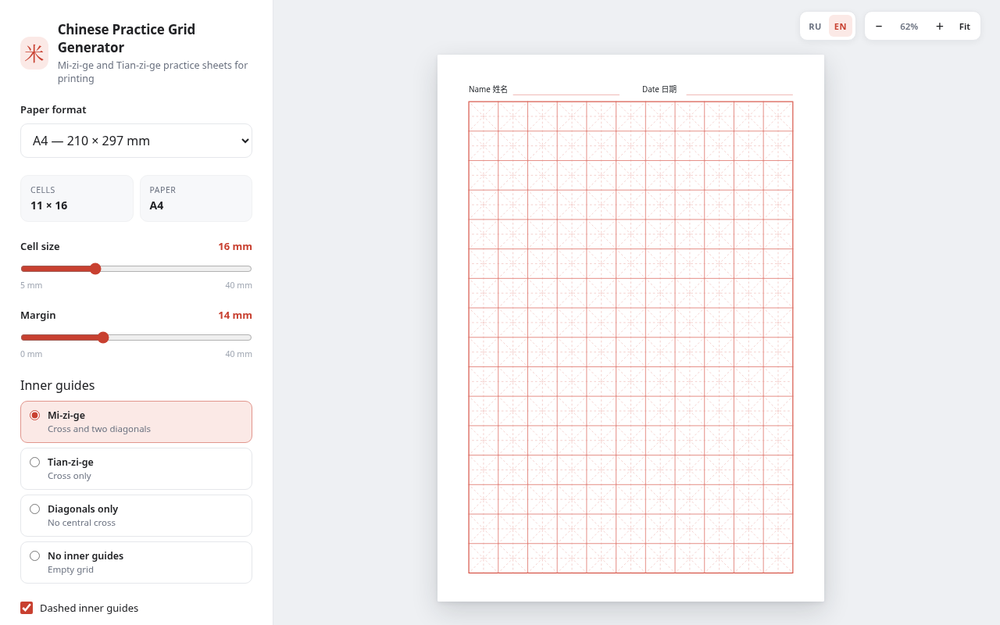

# Генератор китайской клетки

Офлайн-генератор прописей для китайских иероглифов: ми-цзы-ге (米字格),
тянь-цзы-ге (田字格) или пустая сетка. Один HTML-файл, без зависимостей и интернета.

[English](README.md)



## Как пользоваться

1. Откройте `index.html` в браузере.
2. Настройте размер клетки, отступы и внутренние линии.
3. Нажмите **«Печать / PDF»**, затем выберите **«Сохранить как PDF»**, поля — **«Нет»**, масштаб — **100%**.
4. Или нажмите **«Скачать SVG»**, чтобы сохранить векторный шаблон.

Переключатель **RU / EN** в правом верхнем углу меняет язык интерфейса.
Параметр `?lang=en` или `?lang=ru` в URL задаёт язык принудительно.

## Командная строка

```bash
google-chrome --headless --no-pdf-header-footer \
  --print-to-pdf=chinese-grid.pdf \
  "file://$(pwd)/index.html?cell=16&margin=14&guides=mizige&format=a4&lang=ru"
```

`guides`: `mizige`, `tianzige`, `diagonals`, `none`. `format`: `a4`, `a5`, `letter`.
`lang`: `en`, `ru`. Остальные параметры совпадают с настройками в интерфейсе.

`$(pwd)` должен указывать на каталог с `index.html`; путь-заглушка приводит к
`ERR_FILE_NOT_FOUND`.

## Пример

[`example-16mm-a4.pdf`](example-16mm-a4.pdf) ·
[`example-16mm-a4-ru.pdf`](example-16mm-a4-ru.pdf)
